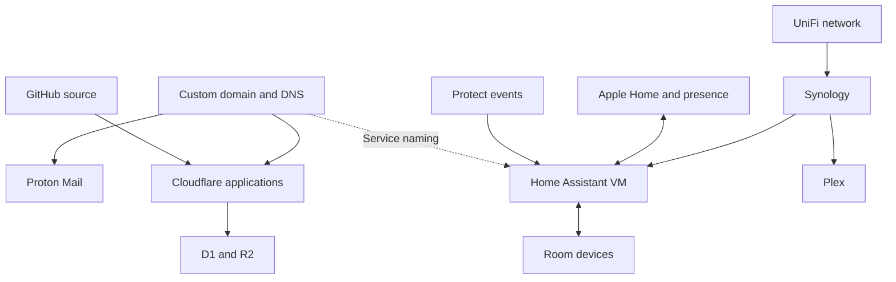

# Home technology guide

A practical guide to the services, devices and integrations I use at home, with enough detail to reproduce one area at a time.

**Begin with [Getting started](docs/getting-started.md).** Choose private email and files, an Apple-friendly smart home, or a private web application. You can also jump directly to a topic below; the whole stack is not a prerequisite.

## How the pieces fit

**Figure — The two connected parts of the setup**

Online applications run independently of the NAS. The dotted naming link represents a custom service name, not a direct connection that bypasses the configured remote-access service.

| Layer | Main tools | Connection to the rest |
| --- | --- | --- |
| Online identity and files | Custom domain, Proton Mail and Drive | DNS keeps email, applications and service names independent |
| Home infrastructure | UniFi and Synology | Networking, VPN policies, local storage, Plex and the Home Assistant VM |
| Household control | Home Assistant, Apple Home and physical buttons | Shared rules connect devices; Apple Home supplies everyday controls and presence |
| Security and alerts | Protect, SuperLink, USL-Smoke and doorbell relay | Local events feed Protect, Home Assistant and configured critical phone alerts |
| Custom applications | GitHub, Cloudflare and transactional email | Reviewed source becomes hosted applications with their own data and access boundaries |
| Off-site data protection | Replication with a family member's DS920 | A second location for selected NAS data |

These are separate systems with deliberate integration points. Proton VPN is outbound routing, not remote access back home. Protect recordings are not Plex libraries. Git history is not a backup of application data.

## Reading order

### Getting started

- [Start here with a smaller setup](docs/getting-started.md)

### Online services

- [Domains and Proton Mail](docs/services/domains-and-email.md)
- [Proton Drive and VPN](docs/services/proton-drive-and-vpn.md)

### Home infrastructure

- [Home networks VPNs and remote access](docs/infrastructure/network.md)
- [Synology storage Home Assistant and Plex](docs/infrastructure/synology-and-plex.md)

### Smart home and daily use

- [Home Assistant and device protocols](docs/home/home-assistant.md)
- [Apple Home devices presence and files](docs/home/apple-home-and-devices.md)
- [Heating ventilation and energy](docs/home/heating-and-energy.md)
- [Household automation examples](docs/home/automation-examples.md)
- [Protect cameras sensors and notifications](docs/home/protect-and-notifications.md)

### Building applications

- [GitHub and Cloudflare applications](docs/apps/github-and-cloudflare.md)
- [Full example building a household helpdesk](docs/apps/helpdesk-example.md)

### Keeping it running

- [Maintenance backups and failure behavior](docs/operations/maintenance-and-failures.md)
- [Official references and scope](docs/references.md)

The topic chapters explain equipment, setup and verification. The [helpdesk example](docs/apps/helpdesk-example.md) is a complete application walkthrough; [automation examples](docs/home/automation-examples.md) shows how household rules interact. [Maintenance](docs/operations/maintenance-and-failures.md) explains backups and dependencies.

## Scope and evidence

The guide is based on household setup work and selected repository configuration through 30 October 2026. It uses fictional domains and omits credentials, private endpoints, account identifiers and personal household data.

Descriptions distinguish **confirmed household use**, **behavior present in reviewed configuration**, and **illustrative or unfinished work**. A rule in GitHub is not proof that the running system has loaded it. Setup sequences explain a replication path rather than exposing live account settings.

Provider menus and plan limits change. Use the official references in each chapter for current instructions. Unconfirmed settings remain identified where they affect replication.

## Maintaining the guide

Each topic has one main chapter. Prefer a short explanation and a link when another chapter needs the same detail. Use branches and review changes before merging; check links and privacy before publication. See [CONTRIBUTING.md](CONTRIBUTING.md).

Older numbered chapter URLs remain as forwarding pages. New links use the topic folders above.
