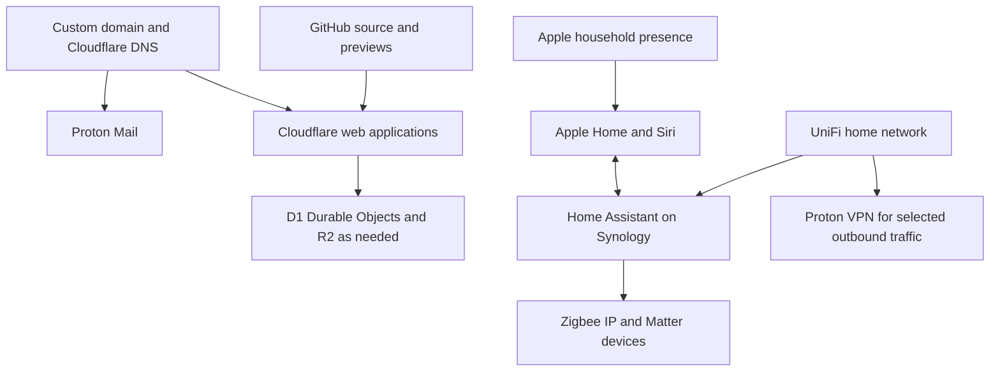

# Home technology guide

Services devices and integrations you can replicate

This guide explains the technology I use at home and for personal projects, how the pieces connect, and how to reproduce one area at a time. The foundation is a custom domain for online services, a UniFi home network, a Synology server, and Home Assistant connected to Apple Home.

You do not need to copy the whole setup. Start with the part that solves a problem for you, prove it works, and add the next layer. A domain and email can stand alone; home automation does not require building web apps.

## How to read this guide

The household examples describe established use unless marked as an example or work in progress. Setup instructions are a replication path, rather than a record of every setting in my accounts. Examples use example.com and generic room names. No credentials, account names, private network addresses, real domains, or household identifying details are included.

| Area | Main tools | Purpose |
| --- | --- | --- |
| Identity and files | Custom domain and Proton | Email identity, private storage and VPN service |
| Web projects | GitHub and Cloudflare | Source control, hosting, APIs and application data |
| Home infrastructure | UniFi and Synology | Networking, local services and virtual machines |
| Home automation | Home Assistant and Apple Home | Device integration, automation and everyday controls |
| Media and energy | Apple TV, Plex and HomeWizard | Playback integration and consumption visibility |

## Contents

- [Domains and Proton Mail](docs/01-domains-and-email.md)
- [Proton Drive and VPN](docs/02-storage-and-vpn.md)
- [GitHub and Cloudflare applications](docs/03-github-and-cloudflare.md)
- [Application examples and email](docs/04-applications-and-email.md)
- [Network server and remote access](docs/05-network-and-server.md)
- [Home Assistant and device protocols](docs/06-home-assistant.md)
- [Apple Home presence and television](docs/07-apple-home-and-media.md)
- [Heating ventilation and energy](docs/08-heating-and-energy.md)
- [A practical rollout and references](docs/09-rollout-and-references.md)
- [Full example building a household helpdesk](docs/10-helpdesk-worked-example.md)

## Architecture at a glance

The domain is a naming layer, not a single host. Home Assistant remote access, web hosting, human email, app email and outbound VPN use distinct paths.

## Status and scope

Based on setup work through 30 October 2026. This is a sanitized replication guide rather than a live configuration audit. Working household patterns, illustrative extensions and unfinished projects are identified in the chapters. No real service addresses, secrets or private configuration values are required to read or reuse it.

## Maintaining the guide

Update the relevant chapter in a branch, check its links and examples, and review the change before merging. Keep personal deployment values in a separate private configuration. See [CONTRIBUTING.md](CONTRIBUTING.md).
