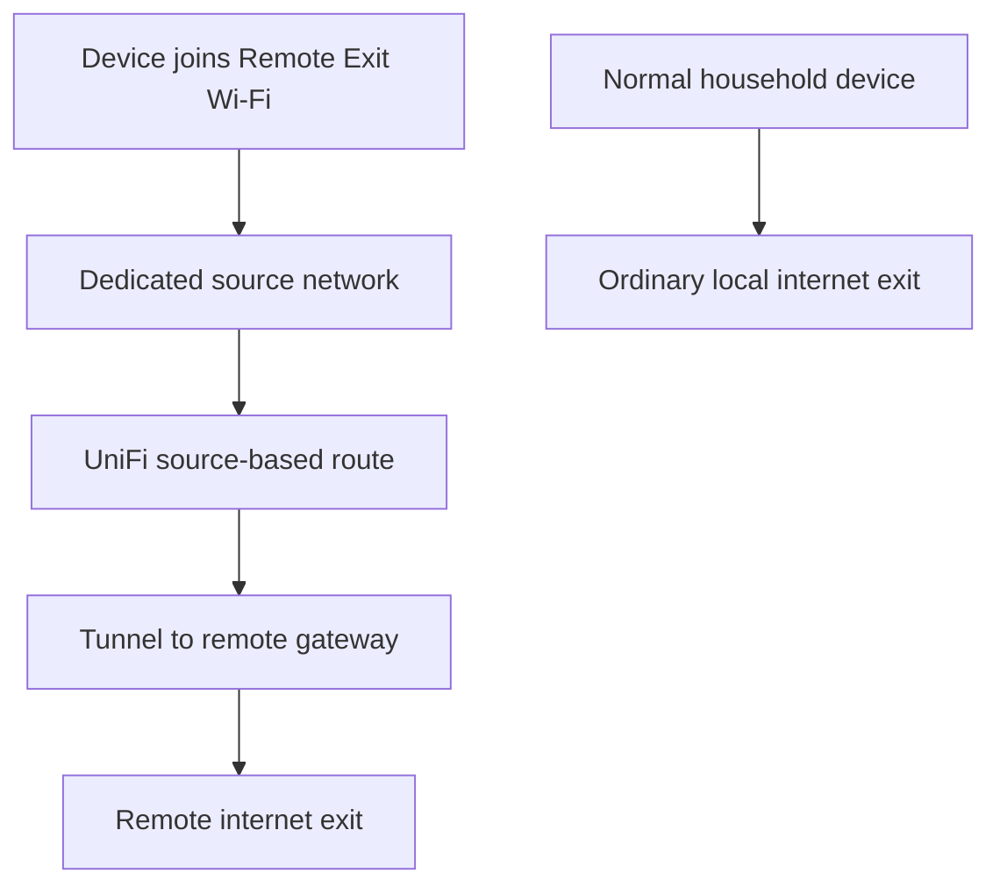
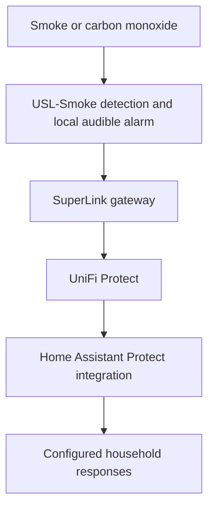
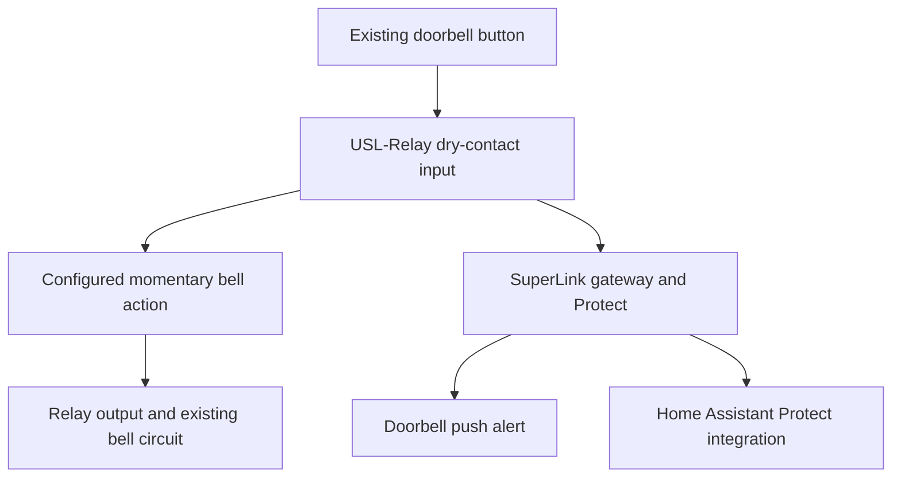

# Network server and remote access

The home network uses a UniFi Dream Machine SE behind an ISP router, UniFi networking and Protect, and a Synology DS920+ NAS. Separate networks give household devices different access and routing behavior. Home Assistant ties selected equipment and events together without becoming the router.

This chapter describes the household architecture and a general replication path. Network names are fictional. Exact VLAN numbers, addressing, remote locations, credentials and live endpoints are omitted. The latest household description confirms the dedicated remote-exit Wi-Fi, Kids network, 2.4 GHz IoT Wi-Fi and selected-site Proton routing. Earlier setup history explains the implementation choices; it is not a live gateway export.

## What the main components do

| Component | Role |
| --- | --- |
| ISP router | Internet handoff upstream of UniFi |
| UniFi gateway | Routing, firewall boundaries, VPNs and traffic policies |
| Managed switching and access points | Carry the intended networks to wired ports and Wi-Fi clients |
| UniFi Network | Configuration and visibility for network equipment and client policies |
| UniFi Protect | Cameras and supported detection events |
| Synology NAS | Local storage, media services and the Home Assistant VM |
| Home Assistant | Integrates devices and reacts to selected events |
| Apple TVs and HomePods | Apple Home hub functions, media and suitable Thread border-router roles |
| HomeWizard | Local meter-reading source for Home Assistant |

The router decides which path a packet takes. Home Assistant decides what an automation should do with a device state. Protect supplies detection events. Keeping these responsibilities separate helps diagnose failures.

## Wi-Fi names networks and VLANs

An SSID is the Wi-Fi name a device joins. A VLAN is a separate logical network carried through capable switches and access points. A separate SSID only gives useful isolation or routing identity when it is mapped to the intended network and policies.

| Household network purpose | Devices or use | Intended behavior |
| --- | --- | --- |
| Main | Trusted computers, phones and everyday Apple devices | Normal household access, with selected-site VPN rules where scoped |
| IoT | Compatible Wi-Fi smart devices | A dedicated 2.4 GHz Wi-Fi network and a separate trust boundary |
| Kids | Children's devices | A dedicated network identity for access and household rules |
| Remote Exit | Devices that should use the remote site's internet connection | Dedicated Wi-Fi mapped to a network routed through the remote tunnel |

These labels describe the design rather than disclosing actual SSIDs. An additional guest network is an optional extension, not a confirmed part of this inventory.

Network separation, client isolation and internet filtering are different controls. Client isolation can prevent peers from talking even within one Wi-Fi network; inter-VLAN firewall rules control movement between networks; filtering controls some external destinations. Do not switch on all three indiscriminately for an automation network.

## The 2.4 GHz IoT network

The household uses a dedicated 2.4 GHz IoT Wi-Fi network. Many small Wi-Fi devices support that band and have simpler provisioning requirements than phones and laptops. Giving them a stable, clearly identified network makes onboarding and traffic policy easier to manage.

Zigbee radiator valves and sensors do **not** join this Wi-Fi. They communicate with the Zigbee coordinator, which Home Assistant uses. Likewise, Thread devices use their Thread mesh and border router rather than joining the IoT SSID directly.

A practical setup sequence is:

1. Create the IoT network and its address range in UniFi.
2. Map the IoT SSID to that network and enable the intended 2.4 GHz band.
3. Choose security settings supported by the actual devices. Test one representative device before migrating a large inventory.
4. Establish DNS and time access, then add only the local and internet access those devices require.
5. Test discovery, control and reconnect behavior from Home Assistant and the commissioning phone.
6. Keep infrastructure and service addresses predictable with reservations where useful.

A device can be connected to Wi-Fi and still fail integration if the controller cannot reach it. Conversely, discovery working does not prove that all required control traffic is allowed.

## Let integrations cross boundaries deliberately

Apple devices have been on the main network while automation devices use the IoT network. That makes discovery and permitted communication between networks important.

| Interaction | What must be considered |
| --- | --- |
| Home Assistant to an IP device | Firewall access to the device's required service |
| Phone commissioning a device | Reachability and discovery during pairing |
| Apple Home to HomeKit Bridge | Discovery and communication with the bridge |
| Matter controller and Thread border router | Local IPv6 and required discovery and traffic paths |
| Home Assistant to HomeWizard | Local API access to the meter |
| Home Assistant to Protect | Reachability and suitable integration authorization |

Multicast discovery such as mDNS may need configuration between selected networks. Enabling discovery forwarding is not the same as allowing every device full access across the firewall.

One concrete household lesson was that disabled IPv6 on the IoT network prevented Matter pairing; enabling it resolved the problem. Local IPv6 for Matter and public IPv6 routing through a VPN are separate issues. Preserve the local connectivity needed for automation while reviewing the internet paths independently.

## The Kids network

A dedicated Kids VLAN provides a stable place to apply network-level rules to children's devices. This is more maintainable than trying to recognize individual apps from whichever household Wi-Fi a device happens to use.

The confirmed design includes a separate Kids network. UniFi filtering and Apple Screen Time have been part of the broader household discussion, but this guide does not claim specific current blocklists, bedtime hours or bypass prevention.

To reproduce the pattern:

1. Create a Kids network and map the intended Wi-Fi to it.
2. Enrol the relevant devices and confirm that they actually receive that network's configuration.
3. Decide which local services are appropriate, such as a printer or selected media service. Permit those paths explicitly.
4. Apply the chosen internet access policy and test it from a child device.
5. Use device-level parental settings for controls that the router cannot reliably provide, such as individual app limits.
6. Verify how a device's private Wi-Fi address affects device identification and reservations.

A network is not an identity system: a device connected to a different SSID may receive different policies. DNS filtering also does not establish that every app, encrypted resolver or VPN follows the intended restrictions.

## Three VPN uses with different purposes

| Use | Traffic selected by | Exit or destination | Household role |
| --- | --- | --- | --- |
| Site-to-site access | Remote private networks and routes | The other site's private network | Connects the two sites |
| Dedicated remote-exit Wi-Fi | Source network | Remote site's internet connection | Makes joining that Wi-Fi select the remote exit |
| Proton VPN for selected sites | Destination policy across included sources | Proton VPN server | Routes chosen destinations through Proton for household users |
| Remote device access | Travelling client's VPN session | Home services | A separate setup that previously remained unresolved |

Connecting two sites does not automatically mean all internet traffic exits through the other site. That needs explicit routing, return-path handling and, where applicable, translation at the exit.

## Site-to-site and dedicated remote-exit Wi-Fi

The household has used UniFi gateways at both ends, with Site Magic for connectivity between sites. Earlier work also established an OpenVPN server and client arrangement for the dedicated network's remote internet exit after some destination traffic failed through the alternative setup.

The important distinction is **private-site connectivity versus remote internet egress**. The dedicated Wi-Fi selects the latter behavior without requiring a VPN app on every connected device.

The exact current tunnel settings should be checked at both gateways before copying an implementation. The guide intentionally does not equate Site Magic being connected with the dedicated Wi-Fi's internet route being correct.

### General replication sequence

1. Establish compatible gateways and working internet connections at both sites.
2. Choose non-overlapping private network ranges.
3. Establish and test the inter-site tunnel independently of Wi-Fi.
4. Create a dedicated local network and map its SSID to it.
5. Add a source-based policy selecting that network and the intended remote-exit tunnel.
6. Configure the far end to accept that traffic, reach the internet, and return responses correctly.
7. Define DNS handling and behavior when the tunnel is unavailable.
8. Test from a client on the special SSID, then compare with the same client on main Wi-Fi.

Test both public IPv4 and IPv6 exit behavior, several destinations, name resolution and reconnects. A public-IP check proves only the path used by that particular test. The remote site's upload capacity, the home connection and tunnel overhead can all limit throughput.

Choose intentionally between stopping traffic when the tunnel fails and falling back to local internet. This is an implementation choice to verify, not an assumed property of the Wi-Fi name.

## Proton VPN for selected sites for all users

The other router-hosted VPN use is destination-based. Instead of telling every person to enable Proton on their phone or laptop, the UniFi gateway sends traffic for selected sites through a Proton VPN client.

The intended behavior is: **included household sources plus selected destinations use Proton; unrelated traffic uses its normal route**. “All users” means all client networks included in that rule, not an automatic guarantee that every VLAN or another device-level tunnel is covered.

For example, a fictional destination list might include service.example.net and its necessary supporting domains. This is an illustration, not a disclosure of the household's selected sites.

### General replication sequence

1. Obtain a suitable Proton WireGuard profile and add it as a VPN client in UniFi.
2. Confirm the tunnel works before adding destination policies.
3. Create a policy with the intended source scope: all relevant clients or an explicit set of household networks.
4. Select the destination domains or addresses using the capabilities of the installed UniFi version.
5. Set the Proton tunnel as the egress for that match.
6. Review exceptions and interactions with source-based routes, particularly the dedicated remote-exit network.
7. Test selected and unselected destinations from more than one device and network.

This is packet routing based on destination matches, not a browser reading page names. A service may use different hosts for login, media, APIs and static content. Shared hosting, changing addresses and DNS behavior can make a domain rule broader or narrower than expected. Check actual sessions when part of a site behaves differently.

The household has also used device-specific Proton routing for selected NAS traffic and direct exceptions for Synology services. These are separate source and destination policies, not evidence that every NAS service or every site always uses one path.

### IPv6 and policy overlap

Earlier tests found IPv4 exiting through Proton while IPv6 still exited through the ISP, even though the downloaded profile contained both address families. A later IPv6 P2P block was narrower than blocking all public IPv6. It must not be described as proof that all traffic used Proton.

When reproducing either VPN path, test the effective result for IPv4, IPv6 and DNS. Define what should happen if the installed routing feature does not cover both families.

Also define what happens if a Remote Exit client visits a Proton-selected destination. The answer depends on the actual route precedence and exclusions. Document the intended winner and verify it; do not assume that source-based and destination-based policies combine automatically.

## Protect smoke and CO alarms

The household uses **UniFi USL-Smoke smoke and carbon-monoxide alarms**. These detect smoke and CO directly and provide their own audible warning. They are not merely listening for another alarm.

Their network integration runs through SuperLink and UniFi Protect, with alarm information ultimately feeding into Home Assistant.

The local warning and network integration have distinct roles. The alarm warns people nearby; Protect and Home Assistant provide visibility and the opportunity for additional responses. Do not make the alarm's basic warning function dependent on Home Assistant.

### Replicate the integration

1. Install the USL-Smoke alarms according to the manufacturer's placement, installation and testing instructions.
2. Set up the SuperLink gateway and adopt the alarms into Protect.
3. Confirm each alarm's connection and available status information in Protect.
4. Add the UniFi Protect integration in Home Assistant with suitable authorization.
5. Inspect the actual entities and events exposed for the installed hardware and software versions. Verify smoke, CO and device-unavailable behavior rather than inferring them from a generic entity name.
6. Configure the intended downstream responses and verify them with the manufacturer's approved test procedure.
7. Check notification delivery independently of the alarm's own audible warning.

The installed equipment and the integration path are confirmed household details. A particular Home Assistant smoke/CO notification or response automation is not specified here because its final rule has not been verified.

Earlier inventories also contained Protect alarm-sound entities. Those are separate capabilities and should not be used to describe the USL-Smoke alarms as acoustic listeners.

See the [official USL-Smoke product information](https://eu.store.ui.com/eu/en/products/usl-smoke) and [Home Assistant Protect integration documentation](https://www.home-assistant.io/integrations/unifiprotect/) for hardware and integration details.

## An existing doorbell made smart with a Protect relay

The household uses a **UniFi SuperLink Relay USL-Relay** to connect an ordinary doorbell button and conventional bell to Protect, with a push alert when the button is pressed. This adds notification capability without requiring the button and bell to be replaced by a video doorbell.

The arrangement has two separate electrical jobs:

- **Input:** the existing button acts as a dry contact to the relay input.
- **Output:** a momentary relay contact operates the existing bell circuit.
- **Power:** the relay has its own DC supply; it does not use its input as the bell's power circuit.

In the household setup, the conventional bell circuit is 12 V AC. This is a description of that installation, not a universal wiring diagram. The [USL-Relay specifications](https://techspecs.ui.com/unifi/physical-security/usl-relay?subcategory=all-physical-security) distinguish signal inputs, power and dry-contact outputs.

The local bell action, Protect event, push delivery and optional Home Assistant response are separate things to verify. The household confirms the doorbell push alert; its exact notification-rule owner is not established in the selected YAML, so this guide does not assign that alert specifically to a Home Assistant automation.

A replication sequence is:

1. Establish the button contact type, bell transformer and bell circuit requirements.
2. Select a compatible relay arrangement and provide its required power.
3. Adopt the relay through the SuperLink gateway into Protect.
4. Connect and test the button input separately from the bell output, following the equipment documentation.
5. Configure a momentary bell action rather than leaving the bell output continuously active.
6. Configure the button event's push notification and test with the phone locked and away from home.
7. Bring the relay's supported states into Home Assistant if additional automations are wanted.
8. Test one press, a held button, repeated presses, and behavior after a restart.

This is a useful example of the wider approach: retain a simple physical interface, use Protect and SuperLink to connect it, and expose useful events to Home Assistant. It does not require every notification or relay action to pass through Home Assistant.

## ISP router and remote access

The UniFi gateway sits behind the ISP router, which means two routing boundaries can affect incoming connections. The household has worked with reservations, DMZ and port forwarding while troubleshooting inbound VPN access. This is distinct from outbound Proton routing and established connectivity between sites.

Remote device access through UniFi Endpoint previously showed “connected” without usable internal or internet access. Do not use a tunnel-status label as the acceptance test. Prove access to the intended resources from cellular data and check the return path.

For a replica, choose a supported ISP handoff and gateway arrangement, then configure only the exposure needed for the chosen remote-access method. An ISP-router DMZ is not a required step for this whole architecture.

## DNS and filtering affect perceived reliability

UniFi also manages local name resolution and traffic policies. Local DNS names can make infrastructure easier to use, but public application DNS and internal service resolution are different responsibilities.

A household troubleshooting example involved slow browsing associated with a UniFi Apple Private Relay content filter. Proton VPN changed the observed behavior because it changed the network path. This does not establish that a VPN fixes every application problem.

When troubleshooting, compare:

- The same destination through ordinary, remote-exit and Proton routes.
- DNS resolution versus connection and application response time.
- IPv4 versus IPv6.
- Filtering enabled versus a controlled test exception.
- Access by permitted local service name versus its expected network destination.

Keep the normal configuration recorded so a diagnostic exception does not become an unexplained permanent setting.

## Synology Home Assistant and Plex

Synology provides local storage and services and hosts the Home Assistant OS virtual machine. Give core services predictable addresses, sensible permissions and a backup arrangement appropriate to their data. A Git repository of YAML is not a backup of the VM or its history.

Plex is part of the media environment, with the NAS and Apple TV. A reproducible pattern is a Plex server reading authorized media folders and an Apple TV client. Prove local playback before adding remote streaming or policy routing.

Home Assistant has used Nabu Casa remote access with a custom hostname. Follow its generated service and certificate-validation DNS records. Cloudflare tunnels have also been explored for selected household services, including Plex. These are service-specific access paths rather than replacements for the entire network. Review current service terms and supported transport before using a tunnel for video.

## Verify the whole design

| Test | What it establishes |
| --- | --- |
| Main Wi-Fi to ordinary destination | Baseline internet behavior |
| IoT device from Home Assistant | Intended local control crosses the boundary |
| Matter commissioning | Relevant local IPv6 and discovery paths work |
| Kids device to allowed and restricted resources | The chosen policy is applied on that network |
| Remote Exit Wi-Fi public-IP and destination tests | Dedicated source routing and far-end internet egress |
| Proton-selected and unselected sites from multiple networks | Destination selection and source scope |
| Tunnel stopped during a controlled test | Actual fallback or blocking behavior |
| IPv4 and IPv6 checks | Whether both families follow the intended path |
| Protect alarm test through Home Assistant | Detection and downstream automation chain |
| Restart of a gateway or service | Recovery behavior rather than only steady-state operation |

## Setup documentation

Provider menus and supported routing features change. The following official entry points are useful when reproducing the design; general routing documentation could not be rechecked during the initial network expansion; the smoke/CO product distinction and relay specifications were subsequently checked.

- [UniFi help and networking documentation](https://help.ui.com/)
- [Home Assistant UniFi Protect integration](https://www.home-assistant.io/integrations/unifiprotect/)
- [Home Assistant HomeKit Bridge](https://www.home-assistant.io/integrations/homekit/)
- [Home Assistant Matter integration](https://www.home-assistant.io/integrations/matter/)
- [Proton VPN support](https://protonvpn.com/support)
- [Home Assistant custom-domain and remote-access references](09-rollout-and-references.md)

See [Home Assistant and device protocols](06-home-assistant.md) and [Heating ventilation and energy](08-heating-and-energy.md) for the automation side.

---

[Back to the guide](../README.md)
