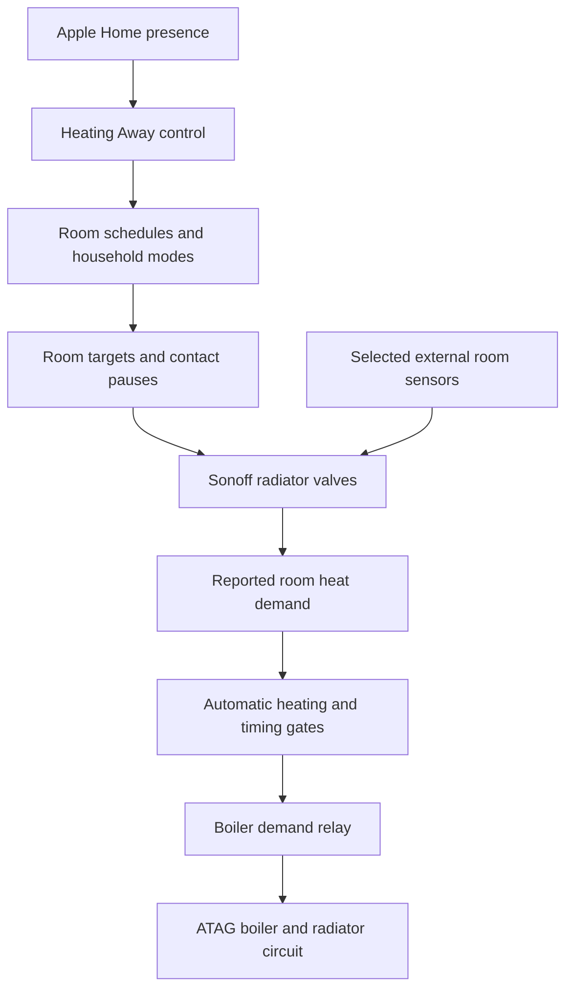

# Heating ventilation and energy

The household uses Home Assistant to coordinate radiator heating, bathroom ventilation and energy monitoring. Apple Home supplies familiar controls and household presence events. HomeWizard supplies meter readings. These systems have different jobs: Apple decides when the household leaves or returns, Home Assistant decides how the equipment should respond, and HomeWizard measures the resulting whole-house consumption.

The behavior below is checked against the selected configuration in GitHub as of 30 October 2026. GitHub records intended configuration; it does not prove that every merged change is currently loaded in the running system. The equipment overview also draws on the established household setup. Exact relay, coordinator and sensor model numbers are not specified where they have not been confirmed.

## Equipment and responsibilities

| Equipment or service | What I use it for | How it connects |
| --- | --- | --- |
| ATAG gas boiler | Supplies hot water to the radiator circuit | Home Assistant controls a boiler-demand relay |
| Boiler relay | Requests central-heating operation | A switch entity in Home Assistant |
| Sixteen Sonoff smart radiator valves | Individual radiator targets and reported heat demand | Zigbee through the Home Assistant coordinator and ZHA |
| Separate temperature and humidity sensors | More representative room temperature and bathroom moisture detection | Sensor entities used by automations |
| Door and window contacts | Pause selected heating zones while an opening remains open | Contact state feeds room-specific pause rules |
| Bathroom towel radiator with smart valve | Scheduled warming, shower boost and manual hold | Part of the same wet heating and demand system |
| Extract ventilation with a switched high setting | High ventilation during humid conditions or a manual run | Home Assistant switch and timer |
| Moes four-button Zigbee scene controls | Fan, lights and heating boost or cancel | ZHA button events mapped to actions |
| HomeWizard P1 meter | Whole-house electricity and gas readings available from the smart meter | HomeWizard integration over the local network |
| Apple Home, Apple TVs and HomePods | Everyday controls, Siri and presence automation | HomeKit Bridge and the Apple home hub |
| Synology DS920+ | Hosts the Home Assistant OS virtual machine | Local VM, networking and coordinator access |

A smart radiator valve controls water flow through its radiator. It does not independently supply hot water. The boiler relay supplies the central heat request. Home Assistant joins those two sides so a room calling for heat can cause boiler operation.

This is relay-based demand coordination in the configuration reviewed here. It should not be described as a confirmed OpenTherm modulation setup. The relay's electrical model and boiler interface must be established for any new installation; this guide intentionally does not prescribe wiring.

## The control path

The normal loop is:

1. Select the appropriate schedule for the day and current time.
2. Apply guest settings, operating mode, temporary holds and relevant contact pauses.
3. Send the permitted temperature targets to the radiator valves.
4. Read each valve's reported heating state.
5. Aggregate the demand and control the boiler relay through confirmation and minimum-off timers.

There is no requirement to send this loop through Apple Home or a cloud application. Apple Home changes the household intent; Home Assistant performs the coordination.

## Room coverage and external temperature sensors

The radiator inventory spans living and dining areas, kitchen, halls and entrance, utility area, sunroom, bedrooms, guest room, study or library, bathrooms and a towel radiator. A radiator-demand inventory and a timetable are separate things: a monitored radiator is not necessarily assigned a new target at every timetable event.

Several valves use separate temperature sensors, including dining, one bedroom and both main bathroom areas. Home Assistant enables the valve's external-sensor mode and writes the corresponding measured temperature to its external-temperature input. The synchronization runs on sensor changes and at Home Assistant startup, skipping invalid readings.

This matters because a sensor beside a radiator can be warmer than the occupied part of the room. External sensing is still sensitive to placement: the dining sensor can be affected by air moving from adjoining rooms. Position, reporting frequency and plausible readings matter as much as the setpoint.

The Sonoff valves in this setup use 0.5°C setpoint increments. The exact models of all sensors and valves should be verified before buying equivalent hardware; not every Zigbee thermostat exposes the same external-sensor features.

## Schedules and operating modes

The timetable uses a winter-schedule helper, a workday classification with school-holiday exceptions, and a guest flag. It refreshes at schedule boundaries and also on startup, relevant mode changes and recovery of selected unavailable radiators.

| Mode or input | Behavior in the reviewed configuration |
| --- | --- |
| Scheduled | Applies the current winter timetable and enables automatic boiler-demand control |
| Workday | Uses earlier morning activity and a daytime setback |
| Non-workday or school holiday | Uses a later household pattern; no routine workday towel preheat |
| Guest visiting | Changes the guest-room profile |
| Minimum heat or Vacation | Stops timetable updates, cancels towel holds and uses 16°C generally, 12°C in entrance and utility areas |
| All Off | Stops the timetable, disables automatic boiler control, releases the relay and commands the radiator inventory off |
| Heating Away | Temporarily selects minimum heat when leaving from scheduled mode, then resumes the current schedule on return |

For illustration, bedroom targets in the current timetable are 20°C during the active period, 18.5°C at night and 16°C during the workday daytime setback. These are configuration choices rather than guaranteed achieved temperatures or universal comfort recommendations.

“Winter schedule off” and “all heating off” are different states. A minimum-heat mode still permits the boiler to run when a room needs its fallback temperature.

## HomeKit presence and Heating Away

Only the household-facing Heating Away control needs to be exposed to Apple Home. Its internal “resume schedule” memory stays in Home Assistant.

The last-person-leaves automation turns Heating Away on. If the winter timetable was active, Home Assistant remembers that it interrupted scheduled operation, runs minimum heat and suspends the normal timetable. That action also cancels towel-rail shower boosts and manual holds.

The first-person-arrives automation turns Heating Away off. If the absence interrupted scheduled mode, Home Assistant resumes the profile appropriate **now**, rather than restoring a stale morning setpoint.

If the household was already in Off or Vacation mode when departure was registered, the away transition does not take over that mode. The return transition has no saved schedule to resume. Startup handling also reconciles a saved away or return transition.

This is temporary setback, not unconditional boiler shutdown. It also is not a promise that guest mode defeats presence: the reviewed away rule checks scheduled mode, not the guest flag. If a guest remains without a tracked phone, use an explicit household presence policy or manual control rather than assuming the system knows.

See [Apple Home presence and television](07-apple-home-and-media.md) for the Apple-side setup.

## Door and window pauses

Open contacts pause mapped rooms after two minutes, and closing must settle for one minute before the delayed pause clears. Briefly opening a door therefore does not continually switch the heating.

Mappings include:

- Front door to entrance heating, with a combined front-door and hallway-window gate for the hall.
- Sunroom opening to the sunroom and connected living and dining area.
- Utility opening to utility and kitchen heating.
- Selected bedroom windows to their associated bedroom radiators.

The common target-setting script stores the intended room state while the room is paused. Schedule changes pass through that same script, so a later timetable event does not simply turn a paused radiator back on. Reconciliation runs on relevant changes, startup and a periodic check.

The towel radiator has no door-pause mapping in the reviewed package. Do not assume every radiator is gated by every open window.

## Boiler demand and timing

A room-demand sensor is based on the thermostat's reported `hvac_action == heating`, with checks for available and recognized states. Room indicators are grouped by floor, and history sensors accumulate demand hours over the last 24 hours.

The relay automation uses:

- **60 seconds of continuously confirmed aggregate demand** before allowing a start.
- **Five minutes of relay off-time** before another start.
- Automatic-heating enable as a separate permission.
- Release of the relay when automatic control is disabled or aggregate demand is no longer on.
- A startup path that releases an already-on relay and lets normal conditions be re-established.

These are demand-control rules, not a complete model of the boiler's own burner logic. Relay on-time, burner operation, radiator water flow and measured gas use are different quantities. A valve can report demand before the boiler is permitted to restart.

Before reproducing this architecture, have the heating system's minimum-flow, bypass and cycling requirements established for that installation. Closing smart valves throughout a wet heating circuit changes its hydraulic behavior.

## Humidity controls the shared extract fan

The fan compares each bathroom with a dining-room humidity reference. The use of a reference lets it respond to a bathroom moisture rise relative to the rest of the house.

| Condition | Action |
| --- | --- |
| Either bathroom is more than 10 relative-humidity percentage points above dining | Requests the fan's high setting when the manual timer is idle |
| Both bathrooms remain less than 5 points above dining for 15 minutes | Releases high speed when the manual timer is idle |
| Fan switches from off to on | Starts a 20-minute timer, including Apple Home, wall-button and automatic starts |
| Fan switches from on to off | Cancels that timer |
| Timer expires and either bathroom is still more than 5 points above dining | Keeps high speed running |
| Timer expires without that qualifying humidity condition | Releases high speed |

For example, with dining at 50% RH, a bathroom above 60% meets the high threshold; both bathrooms below 55% meet the dry threshold. “10 points” means a change from 50% to 60%, not a ten-percent relative increase.

The switch's off state means low ventilation in these automations, rather than a documented complete stop of the ventilation unit. Reproduce the actual electrical behavior of your fan controller.

The high and low thresholds create hysteresis, reducing rapid switching. Both bathrooms matter because a shared fan should not drop to low merely because one room has dried.

A subtlety in the current implementation: the 20-minute expiry checks humidity immediately; it does not itself enforce another 15-minute dry period. The separate normal dry rule has that duration. Invalid sensor data can also prevent automatic high or dry decisions, while the timeout may release high if it cannot establish a humid condition. These are reasons to inspect traces when tuning, rather than describing ventilation as an infallible moisture safeguard.

## Towel radiator schedule and shower detection

The towel radiator is part of the central-heating circuit. Boosting its target asks its valve for heat; it does not switch on a separate electric element.

| Trigger or state | Behavior |
| --- | --- |
| Workday 07:00–07:45 | Target 28°C for preheat, unless a morning shower has already been recorded |
| Primary bathroom more than 10 RH points above dining for 20 seconds | Starts one 30-minute shower countdown when heating permissions allow |
| Continuing high humidity | Does not continually restart the countdown |
| Bathroom below dining plus 5 points for 10 minutes | Clears the shower-event latch so a future shower can be recognized |
| Countdown finishes | Recalculates the normal towel target |
| Qualifying workday shower between 06:00 and 07:45 | Records today's shower to suppress renewed scheduled preheating |
| Winter schedule disabled | Cancels shower countdown and clears the shower latch |

The 28°C value is a thermostat demand target used to open the towel radiator valve. It is not a measured towel temperature or a recommendation to heat the bathroom air to 28°C.

There is no scheduled 07:00 preheat on a non-workday, but humidity can initiate a shower boost when winter scheduling and automatic heating are enabled. A countdown can continue beyond 07:45. If no shower is detected, the ordinary preheat ends at 07:45.

Normal towel targets include 20°C outside the specified workday setback and evening windows, 16°C during workday setback, and 22°C during the workday late afternoon and evening. These were tuned to reduce unnecessary isolated towel-radiator demand; savings must be measured rather than assumed.

## Manual towel holds and physical buttons

A qualifying manual change of the towel setpoint creates a 30-minute hold. The scheduler skips the towel valve while its hold or shower timer is active. Automatic commands are timestamped so their delayed Zigbee reports are less likely to be mistaken for user changes.

The manual-change detector only creates a new hold when the shower timer is idle. The automatic-command exclusion is a timing heuristic, not perfect attribution of every possible asynchronous update.

| Button | Primary bathroom | Second bathroom household mapping |
| --- | --- | --- |
| Top left | Fan toggle | Fan toggle |
| Bottom left | Light toggle | Light toggle |
| Top right | Towel boost | Room-heating boost |
| Bottom right | Cancel towel boost and hold | Cancel room boost |

The primary bathroom button implementation is present in the reviewed configuration. The second bathroom assignment is from household setup discussion; its implementation was not present among the packages inspected for this update.

The primary boost button uses the same 30-minute shower countdown and 28°C target, subject to heating permissions and hold checks. Cancel clears the shower timer and manual hold and suppresses renewed morning preheat before restoring the schedule. The fan toggle uses the shared fan and timer, so button control and Apple Home participate in the same timeout behavior.

## HomeWizard measures the outcome

HomeWizard is the meter-monitoring layer, rather than the room-heating controller. The P1 device reads smart-meter information; Home Assistant brings supported electricity and gas entities into its dashboards over the local network.

To replicate, connect a compatible HomeWizard meter, complete its setup, and follow the [Home Assistant HomeWizard integration instructions](https://www.home-assistant.io/integrations/homewizard/). Enable or authorize the local API as required by that device and supported API version. Then identify cumulative consumption and instantaneous power correctly. [HomeWizard's API guide](https://api-documentation.homewizard.com/docs/getting-started/) explains that update frequency depends on the device and meter.

Keep these measurements distinct:

| Measurement | Meaning | What it cannot establish alone |
| --- | --- | --- |
| Electrical power in W | Present electrical load | Gas boiler fuel consumption |
| Cumulative electricity in kWh | Total electrical energy counter | Individual circuit or appliance breakdown |
| Cumulative gas in m³ | Metered household gas | Which radiator caused the consumption |
| Room demand hours | Time a valve reported heating demand | Heat delivered or exact room cost |
| Boiler relay state | Whether central heat was requested | Actual burner firing throughout that interval |
| Room temperature and target | Measured condition and desired setting | Whole-building heat loss by themselves |

Gas reporting may be less frequent than power reporting. Retain original timestamps and calculate counter differences over sensible intervals. Domestic hot water and other gas appliances can share the gas meter, so do not assign all gas in a towel-only-demand interval to the towel radiator.

## Dashboards and contract costs

The heating views bring together room targets and actual temperatures, which rooms and floors are calling, demand durations, floor temperature averages and boiler relay operation. Comparing these reveals cases such as one small radiator keeping central demand active.

The energy work also uses timestamped consumption with configurable seasonal tariff windows. The P1 meter's tariff labels need not match the time bands in the electricity contract. Summed consumption and actual timestamps provide the input; the contract configuration selects the applicable rate.

Keep fixed daily charges separate from unit-based consumption. Compare calculated totals with known meter intervals and the bill before treating the cost estimate as validated. Recent additions were still awaiting live-data checking. The same time windows inform the household washer and dryer scheduling guide.

## Reproduce and verify one layer at a time

1. Establish Home Assistant, reliable Zigbee coverage and one calibrated radiator valve. Prove temperature readings and command response.
2. Add a representative external sensor if needed, then verify that the valve is actually using it.
3. Establish the boiler-demand interface and system-specific requirements with the installer. Test normal demand, no demand and unavailable-device behavior.
4. Add the timetable and explicit Scheduled, Minimum Heat and Off modes.
5. Add contact pauses and prove that a schedule update cannot defeat an open-window pause.
6. Expose Heating Away through HomeKit Bridge. Test last-person departure, first return, a restart while away and departure from an existing Off mode.
7. Add humidity reference and bathroom sensors. Observe normal and shower histories before adopting the example thresholds.
8. Add fan high control, timeout and dry-down logic; test one wet bathroom while the other is dry.
9. Add towel preheat, shower countdown, manual hold and cancel. Test no shower, early shower, late shower and restart during a countdown.
10. Integrate HomeWizard and compare demand histories with meter increments. Tune one behavior at a time.

[Home Assistant and device protocols](06-home-assistant.md) covers the host and integration layer. [Apple Home presence and television](07-apple-home-and-media.md) covers the everyday control surface.

---

[Back to the guide](../README.md)
