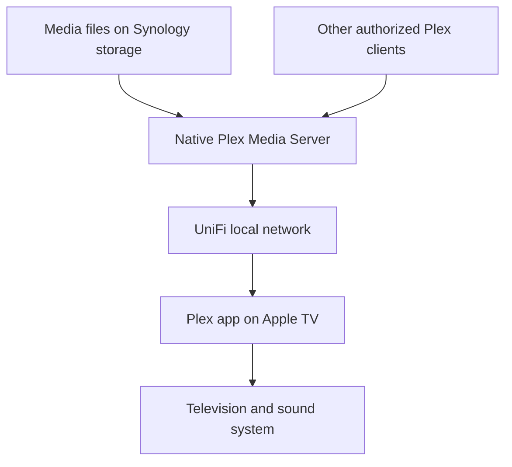

# Synology storage Home Assistant and Plex

The Synology DS920+ is the local server behind several parts of the household setup. It stores files, runs Plex Media Server as a native DSM package, and hosts Home Assistant OS in a virtual machine. Apple TV provides a familiar television interface, while UniFi supplies the network paths and routing policies.

This chapter describes established household use and a general replication sequence. Disk count, RAID or SHR choice, memory upgrades, exact shared-folder layout and Plex Pass status are not confirmed here. Example folder names are illustrative; they do not disclose the household's storage paths.

## What runs on the NAS

| Layer | Household use | Responsibility |
| --- | --- | --- |
| Synology DS920+ hardware | Always-on local server | Storage and compute |
| DSM | NAS operating environment | Storage management, users, shares, packages and administration |
| Native Plex Media Server package | Media server | Library indexing, metadata and playback delivery |
| Virtual Machine Manager | Hosts the Home Assistant VM | Virtual hardware, networking and VM operation |
| Home Assistant OS VM | Automation platform | Integrations, helpers and household rules |
| Network shares | Local file access | Controlled access from computers and services |
| Remote Synology systems | Family-hosted services and some replicated shares or backups | Off-site access and selected data copies |

The preference in this setup has been native management tools and graphical interfaces rather than introducing Docker for everything. Plex does not require a container here. A virtual machine and a native package are different installation models.

Consolidation has a tradeoff: restarting DSM or losing the NAS can affect both media and Home Assistant. Plan updates with that dependency in mind.

## Storage concepts before installing applications

A useful way to think about Synology storage is:

- A **storage pool** organizes physical disks and the selected redundancy arrangement.
- A **volume** provides the filesystem space used by shares and applications.
- A **shared folder** organizes data and access permissions.
- A **user or service identity** determines who can read or change that data.

Those are setup concepts, not a statement that the household uses a particular RAID layout.

For a replica, choose the storage arrangement based on usable capacity, fault tolerance and recovery requirements. Disk redundancy can keep a system available after certain drive failures; it does not protect against every deletion, application error or loss of the NAS.

Create deliberate shared folders rather than letting every service write into one large folder. An illustrative layout is:

| Example share | Purpose | Access pattern |
| --- | --- | --- |
| Documents | Household files | Named users with appropriate read and write access |
| Media | Authorized movies, television and music | Users manage files; Plex receives required access |
| Backups | Backup destinations | Restricted to the relevant backup tasks |
| Transfers | Temporary incoming files | Separate from curated media and important documents |

Separating transfers from curated libraries avoids confusing incomplete files with ready-to-play media. These names and permissions are a proposed replication layout, not a record of the actual shares.

## Set up DSM and file access

1. Install and update DSM using the supported process for the hardware.
2. Establish the chosen storage pool and volume and review storage health.
3. Give the NAS a predictable network address through a reservation.
4. Create user accounts and shared folders with suitable permissions.
5. Configure file sharing for the computers that need it; test access from a normal user account.
6. Establish backups before treating the NAS as the only home for important files.
7. Install one service at a time and confirm it can access only its intended data.

The household has used a custom DSM hostname, HTTPS and certificate configuration. A hostname helps people reach the right service; it does not determine whether that service should be exposed publicly. Keep administration access separate from media access.

A Mac can work with NAS files as network files while Proton Drive supplies cloud file access. The guide does not claim that the NAS and Proton Drive automatically mirror each other. Decide which copy is authoritative and what independently backs it up.

## Native Plex installation

The household Plex Media Server installation uses the Synology package path rather than Docker. A general replication sequence is:

1. Install the supported Plex Media Server package for the Synology platform.
2. Open its setup interface and associate the server with the intended Plex account.
3. Grant the package's service identity the required access to the media folders.
4. Create separate libraries for the relevant media types.
5. Point each library at its intended folder and let Plex scan it.
6. Confirm metadata matching and local playback before adding remote access.

The service identity and permission controls depend on the DSM and Plex package versions. Use their current instructions rather than changing an entire share to broad public access when a scan finds no files.

Plex libraries are indexes over storage locations. Removing or rebuilding a library and deleting the underlying media are different operations. Understand the selected action before changing content-management settings.

Use consistent names and organization so matching is predictable. Exact household media titles and folders are intentionally omitted.

## How playback reaches the television

The DS920+ uses Ethernet. In the previously discussed playback arrangement, Apple TV used Wi-Fi. A wired NAS does not prove that every segment of a playback path is wired or uncongested.

The Apple TV is the playback client. The NAS is the server. The television displays the output. Home Assistant can integrate Apple TV state and controls, but it is not carrying or transcoding the Plex video.

Start with one known local file and one client. Verify smooth playback before trying multiple streams, remote sources or live television.

## Direct Play Direct Stream and transcoding

These modes explain why two files can place very different loads on the same server:

| Playback mode | General meaning | Practical implication |
| --- | --- | --- |
| Direct Play | Client uses the media without server conversion | Usually the lightest server processing |
| Direct Stream | Server repackages compatible streams | Some work without necessarily re-encoding video |
| Transcode | Server converts incompatible or requested media characteristics | Can create substantial processing load |

Client compatibility, selected quality, audio formats and subtitles can influence the result. Do not assume the client is Direct Playing because it is on the same network.

During a playback problem, inspect the active session in Plex and record what is actually happening. Compare the same media with different quality and subtitle choices.

Hardware-assisted transcoding was discussed as a possible diagnostic or improvement for this Intel-based NAS, not as a confirmed enabled household setting. Check current hardware, package and Plex subscription requirements before relying on it. Plex Pass ownership is not established by this guide.

## Remote family servers and site-to-site access

The wider setup includes Synology systems at other family sites, with some shares and backups replicated between them. The exact source-to-destination jobs are not documented here.

Remote stored-media streaming from a family Synology/Plex system has worked in the household. Site-to-site networking is another available path between locations, but Plex account sharing, application access and network routing are separate controls.

For a replica:

1. Decide which person owns and administers each server.
2. Grant only the intended application or share access.
3. Choose the network path and verify it separately.
4. Test playback quality and sustained throughput from the receiving location.
5. Check the server's session details to establish the actual playback mode and path.

An inter-site tunnel does not authorize a Plex user by itself. A Plex account permission does not establish a private network route.

## Live television and HDHomeRun

The household has also explored remote HDHomeRun live television over the site-to-site connection. This is a different workload from reading an existing file from a Plex library.

The useful architectural model is a tuner at one site, a reachable television stream, any Plex live-TV processing involved, and a receiving playback client. The exact tuner-to-server assignment and live-TV subscription settings should be checked before reproducing the implementation.

Earlier testing found that the remote live stream deteriorated after a few seconds even though stored-media streaming worked. Concurrent playback also affected Plex availability. Stopping another stream helped but did not establish a complete resolution.

Possible investigation areas included server resource contention, playback conversion and sustained tunnel throughput. These were hypotheses, not confirmed causes.

The lesson is to validate live TV as its own feature. A connected VPN and one successful movie stream do not prove that the tuner path, live conversion and simultaneous playback will behave well.

## VPN routing and the Synology Direct exception

The NAS has been included in router-hosted VPN policy work. Selected NAS traffic can use Proton, while a direct-route exception for Synology services has helped restore package-service access.

The network can therefore present several paths:

| Traffic purpose | Path to consider |
| --- | --- |
| Local Plex playback | Local LAN |
| Remote family service | The chosen inter-site or application access route |
| Selected outbound NAS traffic | Proton policy route |
| Synology service exception | Direct ISP route where configured |
| Home Assistant remote access | Its configured remote-access service |

A whole-device VPN policy can affect more than the task that motivated it. Package downloads, name resolution, remote application connections and IPv6 may behave differently.

Do not troubleshoot a Plex problem by changing every route at once. Compare local playback, direct internet and the relevant VPN path with one change at a time. The [network chapter](05-network-and-server.md) explains source-based routing, selected-site Proton policies and the observed IPv6 bypass issue.

Transmission has also been part of the Synology setup work. It is a separate package and workload, not a component Plex requires. Third-party package dependency problems have occurred, so its installation status should be verified independently.

## Home Assistant on the same server

Home Assistant OS runs in a VM on the DS920+, managed through Synology Virtual Machine Manager. It has its own operating environment and network identity; it is not simply another Plex plugin or shared folder.

A replication sequence is:

1. Check that the NAS and current virtualization software support the chosen Home Assistant OS VM image.
2. Allocate appropriate compute and storage resources.
3. Connect the VM to the intended home network.
4. Make the Zigbee coordinator available to the VM if using a USB coordinator.
5. Complete Home Assistant onboarding and confirm device access.
6. Test VM and coordinator recovery after a host restart.
7. Configure Home Assistant backups separately from the selected YAML in GitHub.

The household configuration confirms Home Assistant OS, ZHA and a USB coordinator path. Coordinator model, VM resource allocation and extra NAS memory are not prescribed here.

When Plex and Home Assistant share the NAS, monitor the host as well as each service. One demanding workload can affect shared CPU, memory, storage or networking.

## Backups replication and snapshots

Some household shares and backups are replicated between family Synology systems. This confirms an off-site pattern, but not a complete backup inventory.

Keep the purposes distinct:

| Mechanism | Main purpose | Important limitation |
| --- | --- | --- |
| Disk redundancy | Tolerate selected disk failures | Does not independently protect against deletion or total NAS loss |
| Snapshot where supported | Recover earlier filesystem state | May share the same physical failure domain |
| Replication | Maintain another copy at another location | Behavior depends on versioning and deletion handling |
| Versioned backup | Recover selected data and earlier versions | Requires successful jobs and tested restoration |
| Home Assistant backup | Preserve automation configuration and supported data | Must be copied and restored through a suitable process |
| Git | Track selected text configuration | Does not contain all NAS or application state |

Decide which documents, application settings and media are worth backing up and how frequently. Check failures and perform a small restore test. Do not describe a replicated share as a fully verified backup strategy without examining the actual jobs.

Synology CMS, Hyper Backup and Snapshot Replication have been discussed, but their installation and exact current job configuration are not established by this chapter.

## Remote access and custom names

The setup has used custom service names, and a Plex Cloudflare tunnel has appeared healthy in earlier checks. That demonstrates a configured tunnel connection; it does not prove suitability for every video workload or client.

Keep these questions separate:

- Can the service be reached?
- Is access authenticated and authorized?
- Does the Plex client support the chosen path?
- Is sustained playback reliable?
- Do current provider terms support that traffic?

The guide does not prescribe Cloudflare Tunnel as the default way to carry Plex video. Check current service terms and the supported Plex access options before copying that arrangement.

Plex remote access, a site-to-site VPN and Home Assistant's Nabu Casa access are distinct paths. Exposing DSM administration is not a prerequisite for remote Plex playback.

## A practical troubleshooting sequence

1. Confirm DSM and storage health and whether other NAS services are affected.
2. Test one local file on one client with other streams stopped.
3. Inspect the Plex session for Direct Play, Direct Stream or transcoding.
4. Check server resource use during the problem.
5. Compare another client and a wired network path where available.
6. Only then add the remote path and compare sustained performance.
7. Test live TV separately from stored media.
8. Review VPN routing, DNS and IPv4/IPv6 behavior if the fault follows a particular path.
9. Inspect logs and make one controlled change at a time.

If stopping a second stream helps, that narrows the investigation but does not identify CPU as the cause by itself. Preserve the distinction between an observed symptom and a measured explanation.

## Start small

A useful first replica is a NAS with protected file shares, one backup job and one Plex library playing locally on Apple TV. Add Home Assistant virtualization, remote family access, policy routing and live TV as separate milestones.

Official starting points are [Synology Knowledge Center](https://kb.synology.com/) and [Plex Support](https://support.plex.tv/). Their current package, permissions and subscription details could not be rechecked during this chapter update; this walkthrough therefore avoids prescribing version-specific settings.

---

[Network server and remote access](05-network-and-server.md) · [Home Assistant and device protocols](06-home-assistant.md) · [Back to the guide](../README.md)
