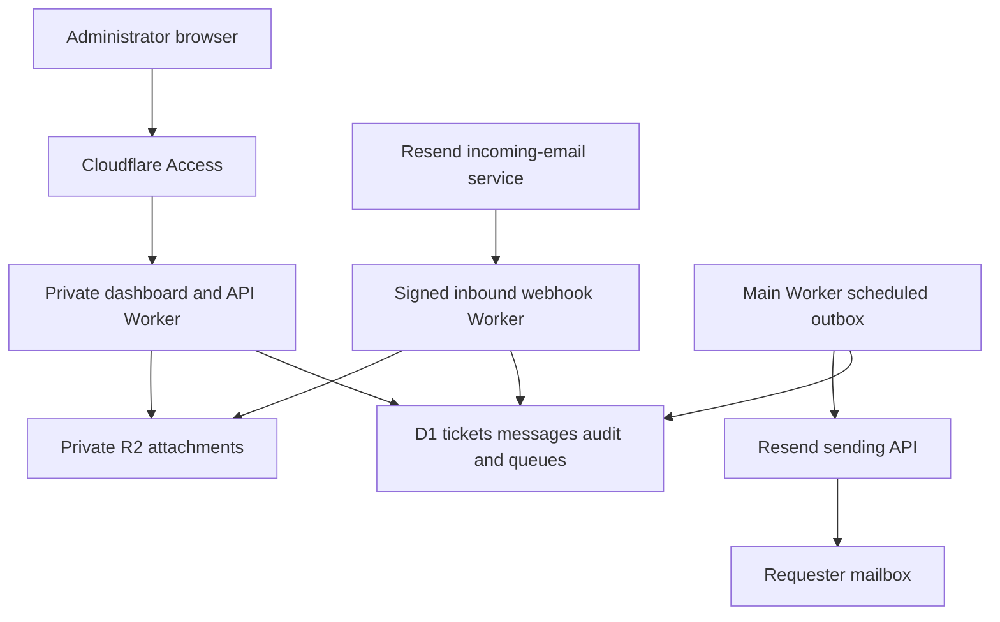

# Full example building a household helpdesk

Building applications · [Guide contents](../../README.md) · [Previous](github-and-cloudflare.md) · [Next](../operations/maintenance-and-failures.md)

The household helpdesk is a practical example of using a custom domain, GitHub and Cloudflare together. It takes a familiar problem—requests arriving in messages—and gives it a ticket queue, a private dashboard, persistent history, attachments and email acknowledgements.

This is an architectural walkthrough of the actual repository, checked on 30 October 2026. Examples use fictional service names. It is sufficiently detailed to plan a replica, but it is not a copy of the application source or a claim that every configured feature has passed production acceptance.

## What the application does

The inspected main Worker provides manual ticket creation, a queue and ticket details, status and priority changes, categories, assignment, resolution fields, internal notes, audit history and attachment access.

Tickets have displayed codes such as INC-0001. The lifecycle is open, in progress, waiting, resolved and closed; a ticket can be reopened. P1–P4 priorities let the interface express urgency.

The household project also includes humorous corporate-style messaging, but that is presentation. Reliable intake, storage and delivery are the underlying system.

The newest migration adds relationship and follow-up tables. That is evidence of schema work, not proof that follow-up UI, scheduling or metrics are finished. Assets, a knowledge base and escalation features remain separate development items.

## Architecture



There are two deployed Workers, sharing storage but using different authentication:

- The dashboard Worker serves people who sign in through Access.
- The webhook Worker accepts a provider's signed machine requests.
- Scheduled handlers process recorded work without a browser needing to remain open.

There is no requirement to expose the home NAS or forward an inbound router port for this application.

## Plan the domain layout

| Name | Role |
| --- | --- |
| helpdesk.example.com | Private administrator dashboard and API |
| inbound-helpdesk.example.com/webhooks/resend | Provider webhook endpoint |
| help@intake.example.com | Test or application receiving address |
| help@notifications.example.com | Verified outgoing identity |
| help@example.com | Human-facing support address retained at Proton until forwarding is verified |

The inbound HTTP hostname and receiving email domain are different things. Configuring one does not configure the other.

Keep main-domain mail at Proton. The intended transition forwards the existing help address into a tested receiving route rather than replacing the whole domain's MX records. See [Domains and Proton Mail](../services/domains-and-email.md).

## Step one establish the repository and local tools

Create a private repository with the main Worker, webhook subproject, SQL migrations, tests and workflows. Install a supported Node.js version and the project's dependencies.

The actual main package provides commands for Wrangler development, deployment, local migrations and remote migrations. A replica could use:

```bash
npm install
npx wrangler dev
npx wrangler d1 migrations apply household-helpdesk --local
```

These are illustrative commands: the database name must match your configuration. A local development database is not the production database.

Begin with a small vertical slice: create a ticket, list it, update it and see the change after refreshing. This proves the browser, API and storage path before introducing email.

## Step two create persistent storage

Create a D1 database and a private R2 bucket, then bind them in each Worker that needs them.

| Data | Storage | Reason |
| --- | --- | --- |
| Ticket identity and status | D1 | Structured records and queries |
| Message text and audit entries | D1 | Ordered history attached to a ticket |
| Inbound event identifiers and states | D1 | Deduplication and retry tracking |
| Outgoing acknowledgements | D1 outbox | Durable pending work |
| Attachment metadata | D1 | Links a file to a ticket and message |
| Attachment bytes | R2 | Object storage rather than database rows |

Review the SQL before applying migrations. The original repository includes a household-specific seed migration; a replica should omit or replace that sample data rather than importing someone else's incident history.

Apply the intended schema locally first. Run the remote migration workflow only against the correct account and database, after reviewing its effect. Applying a migration is different from deploying JavaScript.

## Step three protect the administrator application

Configure Cloudflare Access for the dashboard hostname and permit only the intended administrators. Protect the APIs as well as the page.

The current application requires an enable flag and compares the Access-authenticated email header with a configured administrator identity. That design depends on Access being enforced upstream and preventing untrusted identity headers from reaching the application as if they were genuine.

Consequently:

1. Establish the Access boundary before enabling production access.
2. Configure the permitted administrator identity privately.
3. Keep default Worker and preview URLs disabled, as the inspected configuration does.
4. Confirm an unauthenticated browser cannot read ticket data or download attachments.
5. Test the actual hostname, not only a local development session.

The current source treats the health endpoint and banner asset separately from the application authorization check. Describe those exceptions accurately; an external Access policy may still cover them. Do not assume every route executes identical application checks.

## Step four deploy through GitHub Actions

Add a suitably scoped Cloudflare deployment token and account configuration as Actions secrets. Configure the repository's production environment.

The project's main workflow deploys on main-branch pushes or manual dispatch when its deployment gate is enabled. The inbound Worker has a separate manually triggered workflow and gate. Remote database migrations are manual.

For a replica, complete the resource bindings, Access policy and secret configuration before enabling deployment. After each workflow, inspect the logs and then verify the actual application. A skipped job is not a successful deployment.

Resource declarations, code and DNS-related custom-domain bindings can travel through deployment configuration. Mail-provider setup, Proton forwarding and Access policies still need their own configuration.

## Step five understand the two email intake implementations

The repository contains an earlier direct Cloudflare email-handler path and a newer separate Resend webhook path. They should not be described as one mandatory pipeline.

| Path | Entry | Implementation |
| --- | --- | --- |
| Direct email handler | Worker email event | MIME parsing in src/email-intake.js |
| Provider webhook | Signed HTTP event on separate Worker | Provider API retrieval and scheduled processing under webhook/ |

Some early setup documents still describe intake as unimplemented, while later code implements these paths. This walkthrough follows the inspected code and marks rollout state separately.

Choose and verify the intended receiving path. Do not activate both against the same mailbox without deliberate deduplication and routing design.

## Step six receive signed provider events

The newer webhook Worker exposes a POST endpoint for incoming-email notifications. It checks feature enablement and verifies the signature using a stored webhook secret before recording an email.received event in D1.

The request does **not** need to perform all ticket and attachment processing before responding. It records durable work, then a scheduled handler retrieves the incoming message from the provider API.

The configured source defaults the webhook enable flag to false. Runtime flags and secrets need inspection before claiming the route is live.

Configure the provider to call the exact endpoint and give the Worker the appropriate receiving API credential and signature secret. The webhook endpoint must be reachable by the provider; it cannot require an administrator's interactive Access login. Its signature verification is the machine authentication boundary.

This does not make the administrator application public. The separate hostname and Worker keep the two access patterns distinct.

## Step seven turn received mail into a ticket

The webhook processor:

1. Claims a recorded event for processing.
2. Retrieves the email from the receiving provider.
3. Validates the recipient, extracts the sender and rejects selected automated or loop-prone messages.
4. Checks existing message identity to avoid repeated completion.
5. Looks for a ticket reference in the subject and checks that the sender matches the stored requester before appending.
6. Reserves a new ticket identity when needed.
7. Retrieves and validates supported attachments.
8. Stores the message and file metadata, marks inbound completion and queues a new-ticket acknowledgement.

The inspected newer path uses subject ticket codes plus requester matching. It does not implement all the References/In-Reply-To behavior described in the earlier design notes. Likewise, matching a sender address is an application check, not universal proof of the human sender's identity.

The code includes rate limits for new-ticket creation and bounded processing attempts. The receiver accepts the configured intake address, so a replica must replace the hard-coded example project's recipient and loop-domain checks in its own validation code as well as changing DNS.

That last detail is easy to miss: copying a Worker and changing its hostname does not automatically change application-level address validation.

## Step eight handle attachments privately

The newer path requests attachment information from the authenticated provider API. Download hosts must match an explicit allowlist; arbitrary user-supplied URLs are not accepted as attachment fetch targets.

Supported formats include common images, PDF and plain text. The inspected code limits attachment count and size. D1 stores metadata while R2 holds bytes, with stable keys helping retries avoid duplicate records.

The bucket stays private. Administrator downloads are served through the authenticated main Worker using attachment IDs. The interface is not a public R2 directory.

Configure the provider download-host allowlist from actual legitimate responses. A restrictive but incorrect list can leave mail processing retrying after an event has been received successfully.

Test a plain message before adding an attachment. Then test supported, oversized and unsupported files and interrupted processing.

## Step nine send acknowledgements through an outbox

Incoming mail processing and outgoing delivery are separate operations. A new ticket creates an outbox record, not a guarantee that the requester has already received a response.

The main Worker's scheduled handler calls the outbox processor. Its inspected configuration schedules execution every five minutes. When enabled and configured, it selects pending work and claims each row using a lease before sending through Resend.

The implementation includes:

- A bounded batch size.
- A three-minute sending lease.
- A maximum of five claim attempts.
- Provider idempotency keys based on the outbox row.
- Retry delays and stored failure details.
- A sent timestamp and provider message ID on acceptance.

These mechanisms reduce duplicate sends and make failures visible. Provider acceptance still differs from arrival in the recipient inbox. The current “sent” state must not be represented as full bounce, complaint and final-delivery tracking.

An outbox row sitting pending is a useful diagnostic fact. It may mean the scheduler, feature flag, credential, retry time or deployed binding needs attention rather than that ticket creation failed.

## Step ten configure outgoing identity

Verify the notification sending subdomain with the transactional provider and publish its required DNS records. Keep API keys in Worker secrets.

The main Worker needs sender configuration and an outbound-enable flag before scheduled sending proceeds. The separate webhook Worker needs its receiving credential and signature secret. Neither belongs in browser JavaScript.

| Configuration class | Examples | Where it belongs |
| --- | --- | --- |
| Deployment credential | Cloudflare API token | GitHub Actions secret |
| Runtime sending secret | Resend sending API key | Main Worker secret |
| Runtime receiving secrets | Receiving API key and webhook signature secret | Inbound Worker secrets |
| Resource bindings | D1 and R2 handles | Wrangler configuration |
| Behavior controls | Intake and outbound enable flags | Relevant Worker configuration |
| Human access policy | Administrator allowlist | Access policy and private app configuration |

The earlier design calls for replies to return to intake. Verify actual From and Reply-To headers during acceptance testing: the inspected scheduled sender specifies From, To, Subject and text but does not explicitly set Reply-To. An intended reply route is not complete merely because it is documented.

## Step eleven enable the human-facing address last

Keep the established Proton address unchanged until a direct test intake proves reliable.

First send a message to the dedicated intake address. Then verify a ticket, a supported attachment, a single acknowledgement and a reply linked to the intended ticket. Inspect where an ordinary email client's reply actually goes.

Only then configure and test the forwarding route from the established address. Check that forwarding preserves enough sender and message information for the processor's validation and correlation rules.

Human email, machine intake and sending-domain authentication remain separate DNS responsibilities throughout.

## Acceptance checks and rollout status

| Check | Evidence to look for |
| --- | --- |
| Anonymous dashboard request | No ticket or attachment disclosure |
| Manual ticket | Persists with expected fields and audit history |
| Signed webhook | Records one event; invalid signatures are rejected |
| Scheduled inbound processing | Recorded event becomes completed or a visible retry/failure |
| Duplicate incoming delivery | Does not create repeated completed messages or tickets |
| Reply by requester | Appends to the intended ticket under actual matching rules |
| Another sender with a ticket code | Does not append simply because it guessed the code |
| Attachment | Metadata and private bytes are both retrievable |
| Acknowledgement | One outbox row progresses and provider acceptance is recorded |
| Mail reply | Goes to the configured receiving route |
| Temporary provider failure | Retry state and attempts explain the outcome |
| Disabled feature | Behaves as disabled, rather than silently discarding work |

The repository proves the presence of these implementation mechanisms, not that all acceptance checks passed. Earlier household testing confirmed some outgoing delivery while inbound reliability and queued processing still needed stabilization. Current live feature flags, provider settings and forwarding activation are not audited here.

This distinction is part of the example: code can be implemented, deployed, enabled and verified at different times.

## What to copy into another project

Copy the separation of responsibilities:

- GitHub owns reviewed source and automation definitions.
- Workers run requests and scheduled work.
- D1 holds structured state and pending work.
- R2 holds private object bytes.
- Access authenticates human dashboard use.
- Signed webhooks authenticate provider events.
- An outbox separates durable application work from external delivery.
- Distinct domain roles keep Proton inboxes independent of application mail.

The same pattern can support a repair tracker, club request queue or small private administration tool without reproducing the household's actual data or naming.

---

[Guide contents](../../README.md) · [Previous](github-and-cloudflare.md) · [Next](../operations/maintenance-and-failures.md)
