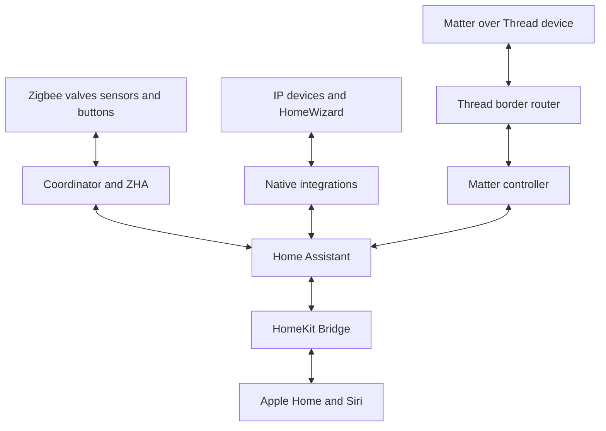

# Home Assistant and device protocols

Smart home and daily use · [Guide contents](../../README.md) · [Previous](../infrastructure/synology-and-plex.md) · [Next](apple-home-and-devices.md)

Home Assistant is the integration and automation engine. Apple Home provides familiar controls and Siri. Devices join through their appropriate integration; Home Assistant combines their states into rules. Most of the heating and bathroom logic lives in Home Assistant so it can coordinate devices from different manufacturers.

| Technology | How it fits | Examples |
| --- | --- | --- |
| Zigbee | Local mesh through a coordinator and ZHA | Sonoff radiator valves, Moes buttons and sensors |
| Wi-Fi or Ethernet | IP devices through native integrations | Media players, network systems and some switches |
| Matter over Thread | Matter controller plus a Thread border router | IKEA KAJPLATS lighting |
| HomeKit Bridge | Exports selected Home Assistant entities | Lights, switches and household controls in Apple Home |

## What runs where in my setup

**Figure — Device protocols and the Apple Home bridge**

This is a logical integration view. A compatible Apple TV or HomePod can provide the Thread border router; it does not replace the Matter controller. HomeKit Bridge exposes selected Home Assistant entities to Apple Home.

Home Assistant OS runs as a virtual machine on a Synology DS920+. The NAS provides the host; Home Assistant OS provides the automation environment. The Zigbee coordinator is made available to the VM, and ZHA joins the radiator valves, sensors and scene controls to that radio network. No exact coordinator model is prescribed here because it has not been confirmed.

The practical division is:

| Layer | Responsibility |
| --- | --- |
| Synology and VM | Keep the Home Assistant host running |
| Zigbee coordinator and ZHA | Communicate with paired Zigbee devices |
| Native integrations | Bring in IP devices and services such as Apple TV and HomeWizard |
| Helpers | Store modes, timers, event latches and restoration state |
| Scripts and automations | Calculate targets, coordinate demand and handle exceptions |
| HomeKit Bridge | Expose selected controls and states to Apple Home |
| Apple Home | Siri, familiar controls and household presence triggers |

The heating installation uses an ATAG boiler, a boiler-demand relay and sixteen Sonoff radiator valves. Separate room sensors feed external-temperature values to selected valves. Door and window contacts feed heating-pause logic. Bathroom humidity feeds both extract-fan behavior and a separate towel-radiator shower countdown.

HomeWizard, sometimes easy to confuse with the other “Home” names, supplies meter information. It does not decide which room should heat. HomeKit supplies presence and controls; it does not need to reproduce Home Assistant's radiator schedule.

See [Heating ventilation and energy](heating-and-energy.md) for the full equipment inventory, thresholds, interaction diagrams and verification sequence.

## Organize the automation so it remains understandable

This configuration uses the main configuration file to include automations, scripts, scenes and a directory of packages. Packages group related helpers and logic, such as door pauses, towel control, demand indicators and temporary absence.

A reusable structure is:

- A room-target script that applies changes consistently and respects contact pauses.
- A timetable script that calculates the current profile.
- Mode helpers for scheduled operation, guest use and temporary absence.
- Timers for temporary boosts and manual holds.
- Event latches to distinguish one shower from many humidity updates.
- Demand sensors for rooms and floors.
- A separate boiler-relay automation with explicit timing conditions.
- A dashboard showing the state that explains a decision.

Naming a helper “Away” does not itself create an away mode. An automation must react to it, and the return path must be defined. Similarly, a timer needs expiry and restart handling, not just a start action.

## Replicate the integration layer

1. Boot Home Assistant OS and complete onboarding. Establish a stable local address and install the mobile companion app.

2. Add the Zigbee coordinator to ZHA, then pair a small set of devices. Use clear names by room and function. Put the coordinator where interference and radio coverage are manageable.

3. Add native integrations such as Apple TV and HomeWizard. Verify state changes in Home Assistant before writing rules around them.

4. Create helpers for shared modes, timers and overrides. Group multiple physical lights into one useful room control. Add a dashboard that makes both current state and exceptions visible.

5. Add HomeKit Bridge and expose a deliberate list of entities to Apple Home. This is the direction from Home Assistant to Apple Home; HomeKit Device is a different integration for bringing compatible accessories into Home Assistant. [reference 7](../references.md)

## Matter Thread and the IPv6 lesson

Matter is an application protocol; Thread is a low-power IPv6 network. A Thread border router connects that mesh to the home IP network. Suitable Apple TVs and HomePods provide this role, alongside their Apple Home hub functions. The Apple TV media integration does not itself configure the Thread network. [reference 8](../references.md)

Pair with the supported phone and Home Assistant commissioning flow, or use Matter multi-admin sharing from an existing controller. Make sure the correct Thread credentials are available. Do not factory-reset everything just because discovery stalls.

In this household, enabling IPv6 on the IoT network resolved a Matter pairing problem. Also check multicast discovery and firewall paths between the phone, controller and border router. Local IPv6 support for Matter is distinct from allowing unrestricted public IPv6 traffic around a VPN policy. [reference 8](../references.md)

## Make changes through Git and load them deliberately

Selected YAML configuration is version controlled in GitHub. The household workflow pulls merged changes into Home Assistant through the File Editor environment, validates the configuration, and then reloads the relevant part or restarts where required.

A GitHub merge does not automatically change the running instance. New package helpers and integrations may need a restart; automation or script changes can often use the appropriate reload. Confirm the relevant entities and inspect traces after loading changes.

Keep authentication, secrets, device-specific identifiers and personal history out of a shareable guide. Use a private configuration for actual deployment values. This repository explains the architecture without reproducing those values.

---

[Guide contents](../../README.md) · [Previous](../infrastructure/synology-and-plex.md) · [Next](apple-home-and-devices.md)
