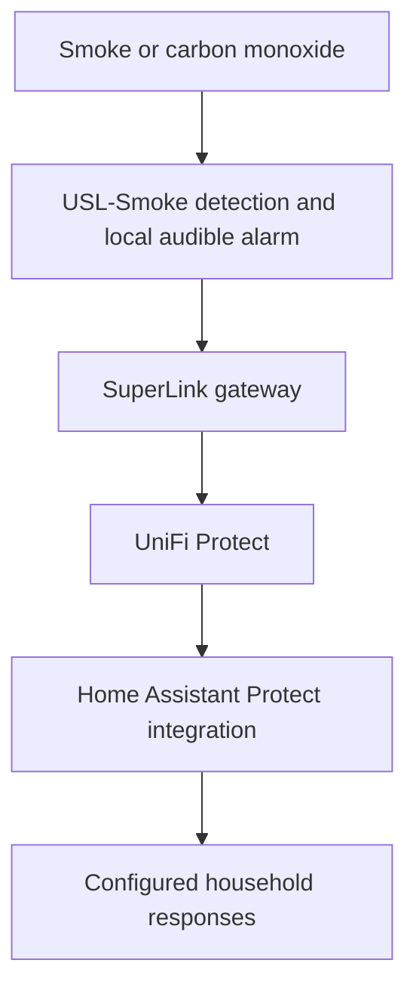
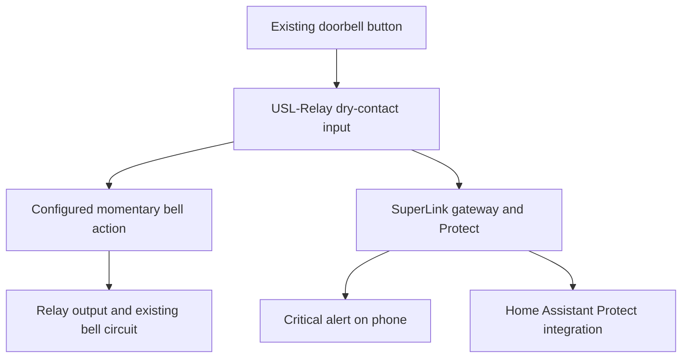

# Protect cameras sensors and notifications

Smart home and daily use · [Guide contents](../../README.md) · [Previous](automation-examples.md) · [Next](../apps/github-and-cloudflare.md)

UniFi Protect is the household camera and connected-security platform. Its events also become inputs to Home Assistant, allowing security equipment and household automation to cooperate.

The confirmed setup includes Protect cameras and sensors, USL-Smoke smoke/CO alarms, a SuperLink relay on the conventional doorbell and critical phone alerts for doorbell presses and smoke/CO. Exact camera inventory, recorder storage, recording schedules, retention and the application owning each critical alert have not been fully inventoried.

## Separate recording events and responses

| Layer | Responsibility |
| --- | --- |
| Camera or sensor | Captures video or detects a supported condition |
| Protect and recording storage | Manages devices, footage and events as configured |
| Protect phone or browser interface | Views the system with the user's permitted access |
| Home Assistant Protect integration | Exposes supported states and controls for automation |
| Notification rule | Decides what message to send and its urgency |
| Phone and app permissions | Determine how the received notification is presented |

A camera view in Home Assistant is not proof that footage is being retained. A sensor state is not proof that a notification was delivered.

Do not assume Plex or the Synology automatically stores Protect recordings. The recorder and its storage need their own documented configuration.

## A camera setup a friend can reproduce

1. Choose compatible Protect hosting and sufficient recording storage for the intended cameras.
2. Adopt one camera and establish a stable power and network path.
3. Set the camera view and the intended recording behavior.
4. Verify both live viewing and playback of an earlier event.
5. Configure named user access appropriate to who should view or manage cameras.
6. Test phone viewing locally and away from home.
7. Add Home Assistant integration after the basic Protect behavior works.
8. Select only useful entities and events for household automations.

This is a general setup sequence rather than a claim that the household uses continuous recording, motion-only recording or a particular number of retention days.

For a replica, deliberately set the recording mode, storage allocation and viewing permissions. Choose camera placement and framing for the intended household purpose rather than copying another home's layout.

## Protect sensors as automation inputs

Door and window contacts can feed both Protect visibility and Home Assistant rules. The reviewed heating package maps selected contacts to radiator pauses, and hallway motion feeds a lighting rule.

That is a useful division: Protect owns its device integration, while Home Assistant interprets a state in the wider household context. Opening a contact can mean “pause heating in these rooms” without needing Protect to understand the heating timetable.

Keep actual contact state separate from a delayed heating-pause helper. The two-minute open delay and one-minute closing delay are heating policy, not a claim that the physical sensor takes that long to report.

## Smoke and CO alarms

The household uses **UniFi USL-Smoke smoke and carbon-monoxide alarms**. These detect smoke and CO directly and provide their own audible warning. They are not merely listening for another alarm.

Their network integration runs through SuperLink and UniFi Protect, with alarm information ultimately feeding into Home Assistant.

The local warning and network integration have distinct roles. The alarm warns people nearby; Protect and Home Assistant provide visibility and the opportunity for additional responses. Do not make the alarm's basic warning function dependent on Home Assistant.

### Replicate the integration

1. Install the USL-Smoke alarms according to the manufacturer's placement, installation and testing instructions.
2. Set up the SuperLink gateway and adopt the alarms into Protect.
3. Confirm each alarm's connection and available status information in Protect.
4. Add the UniFi Protect integration in Home Assistant with suitable authorization.
5. Inspect the actual entities and events exposed for the installed hardware and software versions. Verify smoke, CO and device-unavailable behavior rather than inferring them from a generic entity name.
6. Configure the intended downstream responses and verify them with the manufacturer's approved test procedure.
7. Check notification delivery independently of the alarm's own audible warning.

The household receives **critical alerts on the phone for smoke and CO alarms**. This is confirmed behavior, alongside the alarm's own audible warning and the Protect-to-Home-Assistant integration. The alert owner is not yet identified; see the notification map below.

When replicating, configure critical-alert delivery and the required phone permissions in the app responsible for notifications. Verify the actual alert behavior on the phone, rather than assuming that an ordinary push notification provides the same treatment.

See the [official USL-Smoke product information](https://eu.store.ui.com/eu/en/products/usl-smoke) and [Home Assistant Protect integration documentation](https://www.home-assistant.io/integrations/unifiprotect/) for hardware and integration details.

## Conventional doorbell with SuperLink relay

The household uses a **UniFi SuperLink Relay USL-Relay** to connect an ordinary doorbell button and conventional bell to Protect, with a **critical alert on the phone** when the button is pressed. This adds notification capability without requiring the button and bell to be replaced by a video doorbell.

The arrangement has two separate electrical jobs:

- **Input:** the existing button acts as a dry contact to the relay input.
- **Output:** a momentary relay contact operates the existing bell circuit.
- **Power:** the relay has its own DC supply; it does not use its input as the bell's power circuit.

In the household setup, the conventional bell circuit is 12 V AC. This is a description of that installation, not a universal wiring diagram. The [USL-Relay specifications](https://techspecs.ui.com/unifi/physical-security/usl-relay?subcategory=all-physical-security) distinguish signal inputs, power and dry-contact outputs.

The local bell action, Protect event, push delivery and optional Home Assistant response are separate things to verify. The household confirms critical phone alerts for the doorbell as well as for smoke/CO alarms. The exact notification-rule owner is not established in the selected YAML, so this guide does not assign those alerts specifically to a Home Assistant automation.

A replication sequence is:

1. Establish the button contact type, bell transformer and bell circuit requirements.
2. Select a compatible relay arrangement and provide its required power.
3. Adopt the relay through the SuperLink gateway into Protect.
4. Connect and test the button input separately from the bell output, following the equipment documentation.
5. Configure a momentary bell action rather than leaving the bell output continuously active.
6. Configure the button event's critical phone alert and required notification permissions, then test with the phone locked and away from home.
7. Bring the relay's supported states into Home Assistant if additional automations are wanted.
8. Test one press, a held button, repeated presses, and behavior after a restart.

This is a useful example of the wider approach: retain a simple physical interface, use Protect and SuperLink to connect it, and expose useful events to Home Assistant. It does not require every notification or relay action to pass through Home Assistant.

## The household notification map

| Event | Confirmed behavior | Notification owner known here |
| --- | --- | --- |
| Doorbell press | Critical phone alert | Exact app or rule not yet identified |
| Smoke or CO alarm | Critical phone alert | Exact app or rule not yet identified |
| Heavy rain with monitored window open | Home Assistant configuration requests critical interruption level | Home Assistant companion-app action |
| Ordinary rain with monitored window open | Normal configured phone notification | Home Assistant companion-app action |
| Card-game turn | Push and sound confirmed in project use | Web application notification path |
| Helpdesk new request | Queued email acknowledgement implementation | Worker outbox and transactional sender; rollout still needs verification |

Email acknowledgement, browser push, mobile-app push and a local alarm sound are different delivery mechanisms. They should not be treated as interchangeable urgency levels.

The event source also need not be the sending app. A Protect event can trigger another system, while Protect can have its own notifications.

## Test critical alerts as critical alerts

A normal banner is not evidence that critical presentation works. In the responsible app and phone settings, verify the relevant notification permissions and available critical-alert option.

Use an appropriate controlled test:

1. Identify the exact event and which system owns its notification.
2. Confirm that the event appears at the source.
3. Confirm any integration or automation step.
4. Check that the phone receives the correct event text and urgency.
5. Test with the phone locked and away from home.
6. Test the intended behavior under the phone's silent or Focus settings where supported.
7. Check a second event after the first has been dismissed and look for duplicates.

Exact permission screens and platform behavior change; follow current app and iOS instructions. This chapter records the household's confirmed critical-alert behavior without promising that an arbitrary app can request the same privilege.

## Keep notifications useful

Give a message an actionable event and a readable zone. Use stable notification tags or grouping where supported, and distinguish “device unavailable” from “no alarm.”

The current rain alerts include a six-hour snooze. A snooze is appropriate for that nuisance-management use; it is not a reason to apply the same policy to smoke/CO alarms.

Record which app owns each critical event before adding a second response path. Multiple independent paths can be deliberate redundancy, but unexplained duplication makes testing and troubleshooting difficult.

---

[Guide contents](../../README.md) · [Previous](automation-examples.md) · [Next](../apps/github-and-cloudflare.md)
