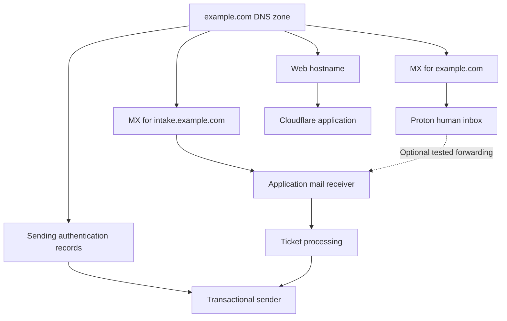

# Domains and Proton Mail

Online services · [Guide contents](../../README.md) · [Previous](../getting-started.md) · [Next](proton-drive-and-vpn.md)

My custom domain provides an email identity that can stay the same when the services behind it change. Proton hosts my human email inboxes, while Cloudflare manages DNS and hosts web applications. GitHub holds application source code. These are separate roles that happen to share the same domain.

The practical benefit is independence: I can move an application without changing my email address, or change email providers without changing the address I give people. This chapter explains the pattern using fictional names.

## Understand the four roles

| Role | What it does | Example in this setup |
| --- | --- | --- |
| Domain registrar | Registers the name and manages renewal | The company where you buy example.com |
| Authoritative DNS provider | Publishes the records directing services | Cloudflare |
| Email provider | Receives, stores and sends human email | Proton Mail |
| Web application host | Runs websites and APIs | Cloudflare Pages or Workers |

Buying a domain does not automatically create a mailbox or website. Moving DNS management to Cloudflare does not require transferring the registration there. Adding a domain to Proton does not move the website to Proton.

Before changing nameservers, copy the existing DNS records into the new DNS provider and review its activation instructions. A nameserver change affects the whole zone, including existing websites and mail.

## Plan the names before changing anything

**Figure — One domain with independent mail and web destinations**

These records can coexist. Web hosting does not move the root-domain mailbox; a receiving subdomain and a notification sender are separately configured. The sending-record branch represents authentication configuration, not incoming mail delivery.

| Example | Intended use | Service |
| --- | --- | --- |
| person@example.com | Personal correspondence | Proton |
| household@example.com | Household contact address | Proton |
| privacy@example.com | Project privacy enquiries | Proton |
| game.example.com | Browser application | Cloudflare |
| home.example.com | Home Assistant access | Its remote access service |
| help@intake.example.com | Machine processing of support mail | Application intake provider |
| no-reply@notifications.example.com | Automated application messages | Transactional sender |

The part after @ is the mail domain. The part before it is the individual address. A web hostname such as game.example.com is not an email address.

This naming plan separates human correspondence, app intake and automated sending. You can reproduce just the Proton part and add the rest later.

## Choose addresses and mailboxes deliberately

“Alias” is used for several different things. Decide which behavior you actually need.

| Type | Example | What it means |
| --- | --- | --- |
| Additional Proton address | household@example.com | Another sending and receiving identity attached to a user |
| Separate user mailbox | another-person@example.com | A distinct person's inbox and access, on a suitable plan |
| Plus address | person+shopping@example.com | A tagged variant useful for sorting |
| Hide-my-email alias | A generated forwarding address | A forwarding identity managed through an alias service |
| Catch-all | Mail to uncreated addresses at example.com | Delivery of otherwise unmatched mail to a chosen destination |

Additional addresses do not automatically provide separate inboxes, passwords or users. Check the plan's domain, user and address allowances before choosing it. Proton's [address guide](https://proton.me/support/addresses-and-aliases) explains the available address types.

For this architecture, a purpose-specific address is useful when a project needs a stable public contact. A filter or label can organize messages inside the mailbox. A separate person should have a separate user where independent access is needed.

## Connect the domain to Proton

Follow the current [Proton custom-domain wizard](https://proton.me/support/custom-domain). Use its generated records rather than treating this guide as a source of live DNS values.

1. Confirm that you control the registrar account and the authoritative DNS zone. Check which company actually hosts DNS; buying the name elsewhere is fine.
2. Add example.com in Proton Mail's domain settings.
3. Publish Proton's ownership-verification record in Cloudflare and let Proton check it.
4. Create the addresses and users that need to receive mail, especially when replacing an existing provider.
5. Follow the wizard for mail routing and authentication. For an existing domain, prepare the receiving addresses before switching MX.
6. Test delivery in both directions with an unrelated mail provider.

The [Cloudflare-specific Proton instructions](https://proton.me/support/custom-domain-cloudflare) cover the provider interface. Make Proton's DKIM CNAME records **DNS only**.

## Read the DNS records by purpose

| Record | Purpose | Typical scope |
| --- | --- | --- |
| Verification TXT | Proves domain control | Name supplied by Proton |
| MX | Selects receiving mail servers | example.com |
| SPF TXT | Authorizes sending infrastructure | The relevant mail-sending domain |
| DKIM CNAME | Publishes access to signing keys | Provider-specific selector under _domainkey |
| DMARC TXT | Sets authentication policy and reporting | _dmarc.example.com |

SPF and DKIM support authentication; DMARC evaluates alignment with the visible From domain and provides policy. They are not encryption settings. Follow [Proton's authentication guide](https://proton.me/support/anti-spoofing-custom-domain).

Publish one SPF policy at a given DNS name. If several senders must use that same name, combine their requirements into the one policy. Keep different providers' DKIM selectors intact.

For a multi-sender domain, review legitimate senders before enforcing a stricter DMARC policy. A reporting address, if configured, must exist and be monitored. A successful DNS check is useful evidence, but real message tests are still necessary.

## Move an existing address without confusing routing and history

Switching MX changes where new messages arrive. It does not move old mail, update correspondents' address books or change every device's mail configuration.

A practical migration sequence is:

1. Inventory the existing addresses, forwarding rules and services that send as the domain.
2. Create the receiving addresses in Proton.
3. Arrange historical mail import separately. [Easy Switch](https://proton.me/support/easy-switch) supports migration workflows; check the source provider and data types it can import.
4. Switch MX during a period when you can test and monitor both providers.
5. Keep the old mailbox available while cached DNS and remaining migration work settle.
6. Verify important folders and messages before retiring the old service.

If changing from a provider-owned address to a custom-domain address, that is also an address change. Update important contacts and account records separately.

## Use the custom address on Apple devices

The custom address belongs to the Proton mailbox, rather than to a particular Mac or iPhone. Start with Proton's web interface or Proton apps, choose the intended From address, and send a test message.

For a compatible desktop mail client, Proton offers [Mail Bridge](https://proton.me/mail/bridge). It runs locally and connects the client to Proton; follow its own setup instructions and generated client credentials. This is an optional replication route, not a claim that every device in my setup uses Bridge.

Do not assume a desktop Bridge arrangement also applies to iPhone Mail. Choose the supported client path for each platform. Test replying as well as composing a new message, especially when several addresses feed one inbox.

## Decide whether to use catch-all

Catch-all can receive a typo or an address you have not explicitly created. It can also collect more junk mail. It is a policy choice, not a prerequisite for custom-domain mail.

Receiving mail through catch-all does not automatically create a sending identity for every possible address. Create an appropriate address when you need to send from it. See [Proton's catch-all instructions](https://proton.me/support/catch-all).

For a first setup, explicit addresses make intended routing easier to understand and test.

## Keep optional alias services separate

Proton Pass and SimpleLogin hide-my-email aliases are an additional layer, rather than another name for a normal Proton Mail address. They can be useful for site-specific signups and disabling unwanted forwarding.

Do not connect the exact same mail domain to competing receiving services and expect DNS to choose by recipient name. Proton documents the conflict when a domain already used for Proton Mail is added to Pass aliases. A separately configured subdomain is a possible design to investigate if you want both services.

This guide does not claim that such an alias-subdomain arrangement is installed in my household. See [Proton's alias instructions](https://proton.me/support/pass-email-alias).

## Coexist with Cloudflare websites and application mail

A website at game.example.com can run on Cloudflare while person@example.com stays at Proton. Keep existing mail records when adding the web application.

MX priority is server preference, not a per-address routing table. Adding another provider's MX records beside Proton's does not mean “send help to the app and person to Proton.”

For my helpdesk architecture, the intended division is:

- Root-domain human mail remains at Proton.
- An intake subdomain receives messages for machine processing.
- A separate notification subdomain authenticates the application sender.
- Forwarding from the established human-facing support address is enabled only after intake is reliable.

Configure each subdomain with its provider's own records. Root-domain MX records do not automatically configure mail reception for every subdomain. Set the application's Reply-To deliberately so responses reach the intended mailbox or ticket intake.

See [Application examples and email](../apps/github-and-cloudflare.md) for threading, attachments and delivery retries.

## Automated sending through Proton is also possible

Using a separate transactional provider is an architectural choice, not a statement that Proton cannot send application mail.

Proton currently documents SMTP submission for paid Proton Mail plans with custom-domain addresses. It uses generated SMTP tokens tied to active addresses; the ordinary account password is not the SMTP password. Confirm eligibility and supported settings in [Proton's SMTP instructions](https://proton.me/support/smtp-submission).

Choose the sending service based on runtime compatibility, delivery handling and operational needs. The helpdesk's queued API-based sender is distinct from interactive mail and local Bridge access. Do not put a Proton password, SMTP token or sender API key in browser code or Git.

## Prove the setup works

| Check | Expected result |
| --- | --- |
| External message to each intended address | Arrives in the correct Proton mailbox |
| New outgoing message | Shows the intended custom From address |
| Reply to that message | Returns to the expected destination |
| Message authentication details | SPF, DKIM and DMARC results match the intended sender configuration |
| Website on its own subdomain | Works without changing Proton delivery |
| Deliberately uncreated recipient | Follows your chosen catch-all or rejection behavior |
| Application notification | Uses its configured sender and Reply-To |
| Mobile and desktop access | Both support normal correspondence with the custom address |

If mail goes to the wrong provider, inspect authoritative MX records first. If incoming mail works but outgoing mail is rejected or spammed, examine authentication and sender configuration. If a web deployment breaks mail, compare DNS changes rather than assuming the services must move together.

Keep domain renewal enabled and maintain access to the registrar and DNS provider. Domain ownership is what lets the email identity remain portable.

---

[Guide contents](../../README.md) · [Previous](../getting-started.md) · [Next](proton-drive-and-vpn.md)
